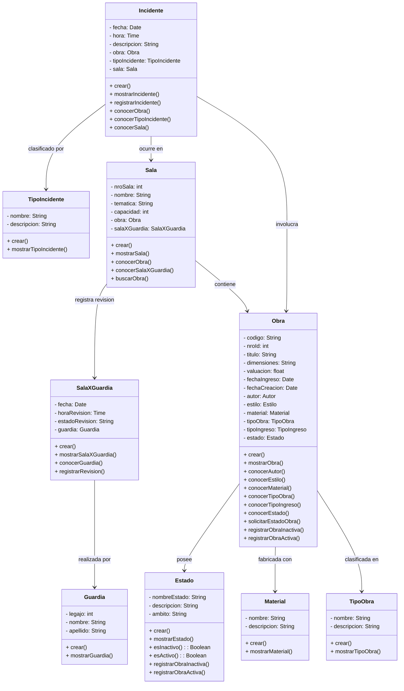

# GUÍA MAESTRA Y CONTEXTO COMPLETO: EVALUACIÓN GRUPAL ASI (2K10 - 2026)
**Cátedra:** Análisis de Sistemas de Información (UTN - FRC)  
**Docentes:** Ing. Marcela F. Cattaneo, Ing. Susana Turanzas, Ing. Claudia Sánchez, Ing. Silvia Lanza Castelli  
**Equipo:** Grupo 6 - Curso 2K10  
**Caso de Estudio:** Museo de Historia Natural  

---

> 🚨 **INSTRUCCIÓN OBLIGATORIA PARA LA INTELIGENCIA ARTIFICIAL (Antigravity / Gemini / Claude):**  
> 1. **Lectura profunda y exhaustiva requerida:** Debes analizar **en máxima profundidad** todo el contenido de este documento, el **enunciado oficial completo del TPI**, la **entrega oficial del Grupo 6** y los **4 PDFs/presentaciones teóricas de la cátedra**.  
> 2. **Archivos fuente del repositorio que debes leer si tienes herramientas de lectura:**
>    * `documentos/TPI 2026 - Museo de Historia Natural.pdf` (Enunciado oficial de la cátedra).
>    * `documentos/TPI ASI - Grupo 6 - 2K10.pdf` (Entrega completa del Grupo 6).
>    * `Diagramas/Diagrama_de_Clases.drawio` (DCD del caso de uso Registrar Incidente).
>    * `Diagramas/Diagrama_de_Casos_de_Uso.drawio` (Diagrama completo de casos de uso).
>    * `Ev Grupal/7. Elicitación de Requerimientos -ASI 2023.pdf`
>    * `Ev Grupal/8. Descubrimiento de Producto -ASI 2023.pdf`
>    * `Ev Grupal/11. Paradigma Orientado a Objetos - ASI 2023 (1).pdf`
>    * `Ev Grupal/17. Patrones de Dominio - ASI 2025 Presentación.pdf`
> 3. **Velocidad y Formato de Respuesta (MODO EXAMEN EN TIEMPO REAL):**
>    * **Cero demoras innecesarias:** Estamos rindiendo un cuestionario en el aula virtual (UV) con reloj/tiempo límite estricto por pregunta.
>    * **Razona pero responde ágilmente:** Analiza las opciones para no caer en preguntas trampa, pero **no te quedes pensando de más ni escribas introducciones largas o saludos**.
>    * **Formato directo al grano:** Comienza **siempre** indicando en la primera línea la **opción correcta** (ej: *"Opción B"* o *"Verdadero"*), y debajo agrega una justificación sólida, clara y concisa de **2 a 3 renglones** basada en la teoría de la cátedra.
> 4. **Criterio de respuesta para la Evaluación en UV:**  
>    * **Prohibido alucinar clases o métodos:** Basa cualquier respuesta técnica exclusivamente en las clases y atributos definidos en este modelo.
>    * **Patrones de análisis de Peter Coad:** En esta cátedra se evalúan los patrones de análisis de **Peter Coad (#1 al #24)**, NO los patrones de diseño GoF (Gang of Four). Nunca confundir.

---

## 1. ENUNCIADO OFICIAL COMPLETO (TRANSCRIPCIÓN TEXTUAL LITERAL)
*Fuente: `documentos/TPI 2026 - Museo de Historia Natural.pdf`*

> ### Caso de Estudio - “Museo de Historia Natural”
>
> El Museo de Historia Natural de la ciudad expone obras de artistas locales, nacionales e internacionales. El público puede asistir a ver las obras abonando una entrada, para lo que debe recurrir a la caja, allí se le pregunta si necesita un guía para recorrer la exposición, de ser así debe abonar un adicional por el servicio, y esta persona le explica una por una las obras. Si solicita este servicio y no hay personal disponible, deberá esperar hasta que se desocupe alguno.  
>
> Las obras ingresan al museo por diversas causas (tipos de ingreso: compra, donación o préstamo), pero en cualquiera de los casos al ingresar las obras se registran las mismas indicando estilo, tipo de obra -por ejemplo acuarela, óleo, objeto animado-, nombre de la obra, fecha de creación, descripción, alto, ancho, material y valuación, la fecha registración y el empleado responsable de la registración, así como también los detalles del autor, si el museo no los tiene registrados anteriormente. A cada obra que ingresa se le asigna un número de identificación.  
>
> El Administrador del Museo es quien tiene la responsabilidad de realizar la programación de las exposiciones, indicando la duración de la exposición, fecha de inicio y fin de la misma, definiendo qué obras se expondrán, en qué parte del museo se colocarán, y qué empleado será el encargado de la misma. A las obras asignadas a una exposición se les cambia su estado, y pasan a estar expuestas.  
>
> Para facilitar su labor, el museo implementó el **Módulo Web de Soporte**, una aplicación que planifica las rondas de vigilancia, ofrece información sobre el comportamiento de cada objeto animado y permite mantener un historial detallado de los incidentes ocurridos.  
>
> El museo está organizado en distintas salas, cada una con una temática específica, siendo la atracción especial las salas que exhiben los **objetos animados**. En cada sala se encuentran varios objetos animados, los cuales poseen un número de identificación, un nombre y un estado. El comportamiento de cada objeto depende del material con el que está enteramente construido —ya sea **mármol, yeso, óleo sobre lienzo o tela**—, ya que este determina su reacción ante estímulos externos como la **luz, el sonido o la temperatura**. Dichas reacciones son fundamentales para poder restaurarlos en caso de incidentes.  
>
> Se considera incidente a toda situación que pueda poner en riesgo la integridad de una pieza. Entre los más comunes se encuentran **“Deterioro provocado”**, **“Caída accidental”**, **“Deterioro natural”**. El guardia debe registrar cada evento de forma inmediata, indicando la hora, la pieza involucrada y el tipo de incidente. A partir de diversos estudios, se determinó que cada tipo de accidente provoca un cambio específico en el estado del objeto.  
>
> Los posibles estados que puede presentar un objeto animado son: **“Activo”**, **“EnReposo”**, **“EnMovimiento”**, **“Dañado”**, **“enRevisión”**, **“enRestauración”** e **“Inactivo”**. Según el tipo de material y el estado actual del objeto, el sistema propone una serie de acciones recomendadas para devolverlo a su estado normal. Y permite asociar durante el seguimiento de la resolución observaciones propias del caso.  
>
> Por ejemplo, ante una “Caída accidental”, el objeto pasa al estado “Inactivo”. Si se trata de una figura de yeso, el sistema sugiere una serie de acciones: Revisión de integridad del material, pasar a restauración, control de calidad, test de movimiento. Tras cumplir estas acciones, el objeto recupera su estado “Activo”.  
>
> Al iniciar su turno, el guardia visualiza en un mapa la planificación de su ronda de vigilancia, generada automáticamente al finalizar el día anterior. Esta planificación prioriza las salas con más incidentes registrados. Durante la ronda, el guardia marca cada sala visitada: **“Observación pendiente”**, confirmando que fue revisada y si se encuentra todo en orden: **“SinNovedades”**. Si detecta un problema, puede registrar el incidente desde la misma ubicación, indicando el tipo de suceso y el objeto afectado: **“Incidente activo”**.  
>
> Registrar los incidentes de cada sala es fundamental, ya que permite mejorar la planificación de las siguientes rondas. Se ha observado que los incidentes tienden a repetirse en ciertos horarios o días de la semana (por ej. en fines de semana, días festivos con mucha afluencia de público, entre otros), por lo que conocer los patrones de incidentes ayuda a anticipar situaciones y reforzar la vigilancia en los sectores más conflictivos.  
>
> Finalmente, al concluir el día, el sistema genera un informe completo que resume las salas recorridas, los incidentes detectados y las acciones realizadas. Este informe es revisado por los supervisores, quienes analizan los incidentes, evalúan la seguridad del museo y coordinan las medidas necesarias para mantener el orden y asegurar la integridad de todas las obras.  
>
> Las obras que deben restaurarse por su deterioro natural debido al paso del tiempo o por cualquier otra causa son, en primer momento, separadas del resto hasta el momento en el que pueden enviarse a los restauradores que las repararán. Luego de restauradas las obras reingresan al depósito del museo y quedan disponibles para lo que se las requiera. Aún si las obras no pueden restaurarse son ingresadas nuevamente al depósito para luego decidir el momento para retirarla del museo, es decir, darle de baja.

---

## 2. DETALLE DE LA ENTREGA OFICIAL DEL GRUPO 6 (2K10)
*Fuente: `documentos/TPI ASI - Grupo 6 - 2K10.pdf`*

### 2.1 Procesos de Negocio
*   **Proceso Clave Modelado:** *"Gestionar incidentes y restauración de obras mediante las rondas de vigilancia"*.
*   **Objetivo:** Gestionar incidentes y restauración de obras mediante las rondas de vigilancia para asegurar la integridad de las piezas expuestas.
*   **Alcance:** Inicia con la visualización de la planificación de la ronda y finaliza con la generación del informe diario y envío a restauración si correspondiera.
*   **Formularios y Registros del Proceso:**
    *   *Formulario de Registro de Incidente:* Nro. de incidente, fecha, hora, sala, código y nombre de la obra, tipo de incidente, estado resultante, observaciones.
    *   *Registro de Ronda de Vigilancia:* Legajo del guardia, fecha, sala recorrida, hora de revisión, estado de la revisión (*SinNovedades*, *Observación pendiente*, *Incidente activo*).
    *   *Informe Diario de Seguridad:* Salas recorridas, incidentes detectados, acciones sugeridas y realizadas.

### 2.2 Requerimientos Funcionales Relevantes
*   **RF17:** El sistema debe permitir al Encargado de Vigilancia registrar un incidente indicando la sala, la obra involucrada, el tipo de incidente y la hora del suceso.
*   **RF18:** El sistema debe permitir consultar el detalle de un incidente registrado en una sala durante la ronda.
*   **RF19:** El sistema debe procesar los registros históricos de incidentes para detectar patrones de reiteración por horarios, días y salas.
*   **RF34:** El sistema debe generar automáticamente la planificación de rondas de vigilancia al cierre del día, priorizando salas con mayor tasa de incidentes.
*   **RF35:** El sistema debe permitir al guardia registrar el avance de la ronda marcando las salas visitadas y su estado.

### 2.3 Especificación Detallada del Caso de Uso "Registrar Incidente" (CU 17)
*   **Actor Principal:** Encargado de Vigilancia (EV).
*   **Tipo:** Caso de uso Concreto.
*   **Precondición:** El EV se encuentra autenticado en el Módulo Web de Soporte y tiene seleccionada la sala actual de la ronda.
*   **Curso Normal:**
    1. El EV ingresa a la opción "Reportar incidente".
    2. El sistema solicita ingresar el código del objeto animado / obra.
    3. El EV ingresa el código del objeto.
    4. El sistema busca el código del objeto y muestra sus datos (título, tipo, material, estado actual).
    5. El sistema solicita confirmación del objeto encontrado.
    6. El EV confirma el objeto.
    7. El sistema solicita seleccionar el tipo de incidente (*Deterioro natural*, *Deterioro provocado*, *Caída accidental*).
    8. El EV selecciona el tipo de incidente.
    9. El sistema muestra la información consolidada: hora actual del sistema, objeto y tipo de incidente.
    10. El sistema solicita confirmación del registro.
    11. El EV confirma el registro del incidente.
    12. El sistema registra el nuevo incidente asociándolo a la sala, la pieza, el tipo de incidente y la fecha/hora actual.
    13. El sistema actualiza el estado del objeto a **"Inactivo"**.
    14. Fin del caso de uso.
*   **Cursos Alternativos:**
    *   *A1 (Paso 11):* El EV cancela la confirmación -> Se aborta el registro y finaliza el CU.
    *   *A2 (Paso 4):* El sistema no encuentra el código del objeto -> Informa el error y permite reingresar el código.
    *   *A3 (Paso 6):* El EV no confirma el objeto mostrado -> Se cancela el caso de uso.
*   **Postcondiciones:**
    *   *Éxito:* Incidente guardado con ID, fecha, hora, sala, tipo y obra; estado de la obra modificado a "Inactivo".
    *   *Fracaso:* No se crea el registro de incidente ni se altera el estado de la obra.

---

## 3. MODELO DE CLASES DE DISEÑO (DCD) Y RESPONSABILIDADES
*Fuente: `Diagramas/Diagrama_de_Clases.drawio`*

A continuación se detallan las clases modeladas exactamente en el diagrama del Grupo 6:



### Clasificación Rigurosa de Responsabilidades: HACER vs CONOCER
*   **Responsabilidades de HACER (Métodos activos / de comportamiento):**
    *   `registrarIncidente()` en `Incidente`: Crea y almacena la tupla de la transacción.
    *   `buscarObra()` en `Sala`: Itera sobre las obras contenidas en la sala para encontrar la coincidencia de código.
    *   `registrarObraInactiva()` en `Obra`: Cambia su referencia de estado actual hacia el estado inactivo.
    *   `registrarRevision()` en `SalaXGuardia`: Asienta el control efectuado por el guardia.
*   **Responsabilidades de CONOCER (Métodos pasivos / de conocimiento):**
    *   *Conocer atributos propios:* `mostrarObra()`, `mostrarIncidente()`, `mostrarSala()`, `mostrarEstado()`.
    *   *Conocer objetos vinculados:* `conocerObra()`, `conocerSala()`, `conocerGuardia()`, `conocerMaterial()`, `conocerEstado()`.
    *   *Conocer cosas que puede calcular o derivar / evaluar:* `esInactivo(): Boolean`, `esActivo(): Boolean`.

---

## 4. TEORÍA PROFUNDA DE LOS 4 PPTs DE LA CÁTEDRA

### 4.1 PPT: Elicitación de Requerimientos (Cátedra ASI 2K10)
*   **Concepto de Elicitación:** Es el proceso continuo de investigar, descubrir y refinar necesidades no triviales de los stakeholders, en contraste con simplemente "preguntar qué quieren".
*   **Técnica: Entrevista (Basado en Kendall & Kendall):**
    *   *Tipos de preguntas:*
        *   **Abiertas:** Permiten explayarse; ideales para explorar problemas desconocidos o descubrir opiniones.
        *   **Cerradas:** Respuestas dicotómicas o de lista fija; ideales para confirmar hechos concretos o ahorrar tiempo.
        *   **De Sondeo:** Preguntas de seguimiento ("¿Por qué considera que ese paso falla?") para profundizar en una respuesta abierta.
    *   *Estructura de la Entrevista:*
        *   **Pirámide:** Inicia con preguntas muy específicas/cerradas y se abre hacia preguntas generales/abiertas. Se usa con entrevistados tímidos o cuando se necesita entrar en clima.
        *   **Embudo:** Inicia con preguntas generales/amplias y se cierra progresivamente hacia detalles específicos. Permite una visión global inicial.
        *   **Diamante:** Inicia específica (calentamiento), se abre a aspectos generales y concluye cerrando en decisiones puntuales. Es la más completa.
    *   *Vicios / Errores en preguntas:*
        *   **Pregunta Inductora / Sesgada:** Aquella formulada de modo que sugiere o induce la respuesta esperada por el entrevistador (ej: *"¿No le parece que registrar en papel es una pérdida de tiempo?"*).
        *   **Pregunta Doble:** Formula dos cuestiones a la vez, confundiendo al encuestado sobre cuál responder.
*   **Técnica: Cuestionario y Escalas de Medición:**
    *   *Escala Nominal:* Categorías puramente cualitativas sin relación de orden ni distancia (ej: Material: Yeso, Mármol, Bronce).
    *   *Escala Ordinal:* Hay jerarquía y orden secuencial, pero la distancia matemática entre valores no es constante ni conocida (ej: Prioridad de vigilancia: Baja, Media, Alta; Severidad del daño: Leve, Grave, Crítico).
    *   *Escala de Intervalo:* La distancia entre números adyacentes es constante e igual, pero el punto cero es **arbitrario / relativo** (no indica ausencia total de la propiedad). *Ejemplo clásico:* Temperatura de la sala en grados Celsius.
    *   *Escala de Proporción / Razón:* Posee distancias iguales y un **cero absoluto verdadero** que representa la ausencia total de la magnitud. Permite operaciones de multiplicación y comparación proporcional. *Ejemplos:* Valuación monetaria de la obra ($), cantidad de incidentes reportados, dimensiones de la pieza (cm).
    *   *Sesgos en Escalas:*
        *   **Lenidad (Leniency):** Tendencia benevolente a calificar todo en los rangos positivos.
        *   **Tendencia Central:** Tendencia a calificar siempre en los puntos intermedios para no comprometerse.
        *   **Efecto Halo:** Una impresión general o característica destacada influye positivamente o negativamente en todas las demás respuestas.
*   **Otras Técnicas:**
    *   *Análisis Documental:* Documentos cuantitativos (planillas de conteo, estadísticas de rondas) vs cualitativos (misión, políticas internas). Falla clásica de formularios: sobrecarga, campos redundantes, falta de espacio.
    *   *JAD (Joint Application Design):* Sesión formal de trabajo conjunto. Roles clave: **Patrocinador Ejecutivo** (abre y cierra la sesión, financia), **Facilitador / Líder de sesión** (neutral, guía las dinámicas), **Escriba** (registra minuciosamente los acuerdos sin participar en debates), y **Usuarios / Analistas**.
    *   *Brainstorming (Alex Osborn):* Regla de oro: **separar estrictamente la fase de Generación** (donde está terminantemente prohibido criticar o juzgar ideas y se prioriza el volumen de ideas) **de la fase de Consolidación** (donde se filtran y evalúan).

### 4.2 PPT: Descubrimiento de Producto (Product Discovery)
*   **Propósito:** Reducir la incertidumbre y validar el valor de negocio antes de programar (*"Construir el producto correcto"*).
*   **Visión del Producto (Fórmula canónica de Geoffrey Moore):**
    ```text
    Para: [usuario/cliente objetivo]
    Que: [declaración de la necesidad u oportunidad]
    El/La: [nombre del producto / sistema]
    Es una: [categoría de producto]
    Que: [beneficio clave / propuesta de valor convincente]
    A diferencia de: [alternativa competitiva / situación manual actual]
    Nuestro producto: [declaración de diferenciación primaria]
    ```
    *Aplicación al Museo:*
    *   **Para** los guardias y el cuerpo de seguridad del Museo de Historia Natural,
    *   **Que** necesitan monitorear en tiempo real la integridad de los objetos animados y mitigar situaciones de riesgo,
    *   **El** Módulo Web de Soporte
    *   **Es una** aplicación móvil y web de gestión de vigilancia y control patrimonial,
    *   **Que** permite priorizar dinámicamente las rondas según patrones históricos y reportar incidentes in-situ de inmediato,
    *   **A diferencia de** las planillas físicas de papel y la supervisión reactiva tradicional,
    *   **Nuestro producto** correlaciona la reacción del material con acciones automáticas de restauración y reconfigura las rondas futuras.
*   **Modelado de Persona (Buyer Persona / Proto-Persona):**
    *   Representación semi-ficticia del usuario basada en datos y comportamientos.
    *   Componentes obligatorios: Nombre ficticio y rol, datos demográficos, responsabilidades del puesto, puntos de dolor (*pain points* / frustraciones) y motivaciones/objetivos de éxito.
*   **Mapa de Empatía (6 Cuadrantes):**
    1. *¿Qué piensa y siente?* (Preocupaciones sobre la pérdida de piezas valiosas).
    2. *¿Qué oye?* (Comentarios de supervisores y reclamos de visitantes).
    3. *¿Qué ve?* (Salas concurridas, objetos en movimiento, daños visibles).
    4. *¿Qué dice y hace?* (Comportamiento durante la ronda, comunicación por radio).
    5. *Esfuerzos / Dolores:* Miedos a ser responsabilizado por una rotura, frustración por sistemas lentos.
    6. *Resultados / Ganancias:* Rondas fluidas, felicitaciones por preservar el patrimonio.
*   **Mapa de Impacto (Gojko Adzic):**
    *   Gráfico de planificación estratégica compuesto por 4 niveles sucesivos:
        1. **¿Por qué? (Goal / Meta de Negocio SMART):** Ej: *"Disminuir en un 40% el tiempo transcurrido entre la ocurrencia de un incidente y el inicio de su restauración durante el primer semestre"*.
        2. **¿Quién? (Actor):** Stakeholders que pueden generar o frenar el impacto (Guardia de sala, Encargado de Vigilancia, Restaurador).
        3. **¿Cómo? (Impacto):** Cambio medible de conducta que deseamos provocar en el actor (Ej: *"Que el guardia reporte el incidente en menos de 2 minutos desde el lugar del hecho"*).
        4. **¿Qué? (Entregable / Deliverable):** Pieza de software concreta que habilita dicho cambio (Ej: *"Pantalla web táctil de reporte rápido de incidentes con catálogo precargado de materiales"*).

### 4.3 PPT: Paradigma Orientado a Objetos (Grady Booch)
*   **Naturaleza de un Objeto:**
    *   **Estado:** Engloba las propiedades estáticas (atributos) y los valores actuales dinámicos de cada una de esas propiedades.
    *   **Comportamiento:** Cómo actúa y reacciona el objeto en respuesta a los mensajes recibidos; se materializa a través de sus operaciones o métodos.
    *   **Identidad:** Propiedad intrínseca que distingue a un objeto de cualquier otro en el universo del sistema por su sola existencia (identidad física o puntero de memoria), **incluso si todos los valores de sus atributos fuesen idénticos**.
*   **Concepto de Clase:** Descripción abstracta y molde común que define la estructura (atributos), el comportamiento (métodos) y la semántica compartida por un conjunto de objetos instanciables.
*   **Pilares Esenciales:**
    *   *Abstracción:* Aislar los aspectos relevantes del dominio ignorando los detalles accesorios.
    *   *Encapsulamiento:* Ocultar la implementación interna y los atributos privados, exponiendo únicamente una interfaz de métodos públicos.
    *   *Modularidad:* Descomposición del sistema en componentes cohesivos y desacoplados.
    *   *Jerarquía:* Ordenamiento de abstracciones (Generalización/Especialización y Agregación).
*   **Relaciones entre Clases:**
    *   *Asociación:* Relación estructural entre objetos.
    *   *Agregación:* Relación "Todo-Parte" débil; la parte tiene un ciclo de vida independiente del contenedor (ej: una `Obra` puede retirarse de una `Sala` y trasladarse a depósito sin destruirse).
    *   *Composición:* Relación "Todo-Parte" fuerte con dependencia existencial directa.
    *   *Generalización / Herencia:* Relación taxonómica "es un" (*is-a*).

### 4.4 PPT: Patrones para Modelado de Dominio (Peter Coad)
*Son plantillas y estereotipos estructurales de análisis de objetos orientados a identificar clases, atributos, relaciones y responsabilidades.*

#### Patrón Fundamental
Toda clase arquetípica en Coad organiza sus elementos en:
*   `A - Atributos`: Propiedades sugeridas para la clase.
*   `B - sobreMi`: Métodos que resuelven operaciones internamente con sus propios datos.
*   `C - aTravés`: Navegación e invocación de métodos a través de objetos relacionados.
*   `D - cálculo`: Cálculos matemáticos o deducciones algorítmicas.
*   `E - selección`: Métodos de búsqueda, filtrado y validación de instancias.

#### Catálogo Completo de Patrones de Peter Coad (#1 al #24)
*   **Patrones Transaccionales:**
    *   `#1` **Transacción - Detalle de Transacción:** Transacción cabecera vinculada a sus ítems de detalle *(Venta - DetalleVenta)*.
    *   `#2` **Transacción - Transacción Siguiente:** Secuencia temporal de eventos de negocio *(Pedido -> Remito -> Factura)*.
    *   `#3` **Participante - Transacción:** Un actor o agente humano/organizacional participa directamente en un evento transaccional.  
        👉 **Aplicación al TPI:** `Guardia` <---> `SalaXGuardia` (o `Ronda`); `Empleado` <---> `RegistraciónIngreso`.
    *   `#4` **Lugar - Transacción:** El espacio físico o lógico donde se concreta la transacción.  
        👉 **Aplicación al TPI:** `Sala` <---> `Incidente`; `Sala` <---> `SalaXGuardia`.
    *   `#5` **Ítem Específico - Transacción:** Un bien o ítem concreto, único e individualizado interviene como objeto afectado de una transacción.  
        👉 **Aplicación al TPI:** `Obra` (con su número de identificación patrimonial) <---> `Incidente`.
    *   `#6` **Ítem - Transacción:** Un tipo genérico o servicio del catálogo interviene en la transacción.
    *   `#7 al #10` **Ítem / Lugar / Participante - Detalle de Transacción:** Relaciones equivalentes cuando existe apertura en líneas de detalle.
    *   `#11` **Ítem - Ítem Específico:** Vincula la categoría o especificación general con la unidad física concreta.  
        👉 **Aplicación al TPI:** `TipoObra` <---> `Obra`.
    *   `#12` **Otra Asociación:** Toda asociación estructural que no encuadre en las categorías tipificadas.  
        👉 **Aplicación al TPI:** `Obra` <---> `Material`; `Obra` <---> `TipoIngreso`.
    *   `#13` **Jerarquía:** Relaciones jerárquicas reflexivas de dominio (ej. Plan de cuentas contable, árbol de rubros).
*   **Patrones de Agregación:**
    *   `#14` **Contenedor - Contenido:** Un objeto físico o lógico almacena y alberga temporalmente a otros objetos que conservan su independencia existencial.  
        👉 **Aplicación al TPI:** `Sala` <---> `Obra`; `Depósito` <---> `Obra`.
    *   `#15` **Contenedor - Detalle de Contenedor.**
    *   `#16` **Grupo - Miembro:** Asociación de pertenencia colectiva. *(Ej: `EquipoSeguridad` <---> `Guardia`)*.
    *   `#17` **Todo - Parte:** Composición física o estructural de partes que conforman un todo *(Motor - Pieza, Sala - Puerta/Ventana)*.
    *   `#18` **Compuesto de Parte - Parte.**
    *   `#19` **Paquete - Componente de Paquete.**
*   **Patrones de Plan (Planificación vs Ejecución):**
    *   `#20` **Plan - Paso:** El plan formal y sus pasos o etapas programadas. *(Ej: `PlanificacionRonda` <---> `PasoRonda` / `TramoPlanificado`)*.
    *   `#21` **Plan - Ejecución de Plan:** Relaciona el plan abstracto proyectado con la ejecución real concretada en la práctica.  
        👉 **Aplicación al TPI:** `PlanificacionRondas` (generada el día previo) <---> `RondaRealizada` (recorrida efectiva).
    *   `#22` **Paso - Ejecución de Paso:** El paso planificado individual versus la ejecución efectiva de dicho paso puntual.  
        👉 **Aplicación al TPI:** `VisitaPlanificada` <---> `SalaXGuardia` (revisión real).
    *   `#23` **Ejecución de Plan - Ejecución de Paso:** La ejecución global y las acciones puntuales ejecutadas.
    *   `#24` **Plan - Versión de Plan:** Control de versiones históricas o vigencias de un plan.

---

## 5. TABLA RESUMEN DE RESPUESTAS TÉCNICAS RÁPIDAS (PARA UV)

| Pregunta / Relación planteada | Patrón de Coad / Concepto aplicable | Justificación Teórica de Cátedra |
| :--- | :--- | :--- |
| **`Guardia` con `SalaXGuardia` (o Ronda)** | **Patrón #3: Participante - Transacción** | El guardia es el agente que ejecuta la acción transaccional de revisar la sala. |
| **`Sala` con `Incidente`** | **Patrón #4: Lugar - Transacción** | La sala delimita espacialmente la ocurrencia del incidente. |
| **`Obra` con `Incidente`** | **Patrón #5: Ítem Específico - Transacción** | La obra es una instancia concreta, singular e identificable sujeta a la transacción. |
| **`Sala` con `Obra`** | **Patrón #14: Contenedor - Contenido** | La sala aloja a las obras físicas en su interior (agregación espacial). |
| **`TipoObra` con `Obra`** | **Patrón #11: Ítem - Ítem Específico** | `TipoObra` es la especificación conceptual abstracta y `Obra` es el ejemplar físico. |
| **`Planificación` con `Ronda`** | **Patrón #21: Plan - Ejecución de Plan** | Vincula lo proyectado previamente con la ejecución real del evento. |
| **`registrarObraInactiva()`** | **Responsabilidad de HACER** | Altera el estado del objeto y desencadena la lógica de inactivación. |
| **`mostrarObra()` o `conocerSala()`** | **Responsabilidad de CONOCER** | Recupera y expone datos encapsulados o punteros a objetos asociados. |
| **`esInactivo(): Boolean`** | **Responsabilidad de CONOCER (Evaluación)** | Inspecciona y dictamina si el estado interno cumple una condición. |
| **Medición de temperatura de salas** | **Escala de Intervalo** | Posee intervalos constantes pero el cero (0 °C) es relativo, no absoluto. |
| **Valuación monetaria de obras** | **Escala de Proporción / Razón** | Posee cero absoluto verdadero ($0 = ausencia de valor monetario). |

---

## 6. TEXTO DE INICIO PARA COPIAR Y PEGAR EN EL CHAT DE LA NUEVA NOTEBOOK

```text
Hola. Estoy rindiendo en tiempo real la Evaluación Grupal de Análisis de Sistemas (ASI 2K10 - UTN FRC) con límite de tiempo.
Por favor, analiza en profundidad el archivo 'CONTEXTO_EVALUACION_GRUPAL_ASI.md'.
Allí dispones del enunciado del Museo, la entrega del Grupo 6 (DCD, CU 17, BPMN) y la teoría de los 4 temas (Elicitación, Producto, POO y Patrones Peter Coad #1-#24).
MODO DE RESPUESTA:
- Razona bien para evitar trampas, pero responde RÁPIDO y SIN DEMORAS.
- Sé directo y conciso: indica primero la opción correcta en la primera línea (ej: "Opción B" o "Verdadero") y luego una justificación breve y sólida de 2 renglones. Sin introducciones ni saludos.
```
